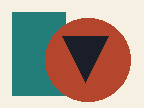
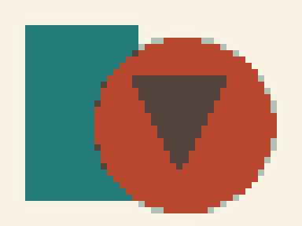

# trifun stitch CLI

Turn images into cross-stitch charts on your own computer. Export printable PDFs,
PNG previews, and JSON, with support for custom thread palettes.

No account or API key is needed. Once installed, conversion runs offline.

| Input image | Generated preview |
| --- | --- |
|  |  |

The example above uses **48 × 36 cells and six RGB colors**. It is generated output,
not a photograph of finished embroidery. The input is a synthetic image by trifun.

## What you can do

- Choose the chart width, maximum color count, and fabric count.
- Generate a printable black-and-white symbol chart and color previews.
- Import your own JSON thread palette and merge duplicate mapped thread codes.
- Keep transparent areas unstitched while counting visible white cells as stitches.
- Export the grid, legend, stitch counts, and rough thread estimates as JSON.

## Quick start

Requires **Python 3.11 or newer**. Tested with Python 3.12 on macOS ARM64.
Dependencies need an internet connection during installation.

Download the repository using **Code → Download ZIP**, extract it, and open a terminal
in the extracted project directory. Check that `python3 --version` reports 3.11 or newer.

```sh
python3 -m venv .venv
.venv/bin/python -m pip install --require-hashes -r requirements.lock
.venv/bin/python -m pip install --no-deps .
.venv/bin/trifun-stitch --help
```

Convert the included example:

```sh
.venv/bin/trifun-stitch convert examples/geometric.png \
  --size 48 --colors 6 --output my-pattern
```

Expected summary:

```text
Created 48 x 36 chart: 1728 stitches, 6 colors.
Palette: RGB reference only. Output: my-pattern
```

Output must be a **new directory**. Choose another name if it already exists.

```text
my-pattern/
├── grid.png       # One RGBA pixel per stitch
├── preview.png    # Enlarged color preview
├── pattern.json   # Grid, palette, symbols, counts, and estimates
└── pattern.pdf    # Overview, legend, and tiled symbol charts
```

On Windows, create the environment with `python -m venv .venv`, then replace
`.venv/bin/python` with `.venv\Scripts\python.exe` and `.venv/bin/trifun-stitch` with
`.venv\Scripts\trifun-stitch.exe`. Windows and Linux have not yet been tested.

## Use your own thread palette

The default output uses **RGB hex values**, not manufacturer thread codes.
Use it as a color reference; it is not a thread shopping list.

To map colors to threads, supply a JSON palette you have the right to use:

```json
{
  "brand": "My thread palette",
  "colors": [
    {"code": "dark", "name": "Dark reference", "rgb": [30, 30, 30]},
    {"code": "light", "name": "Light reference", "rgb": [230, 230, 230]}
  ]
}
```

Try the included synthetic reference palette:

```sh
.venv/bin/trifun-stitch convert examples/geometric.png \
  --size 48 --colors 6 \
  --palette examples/custom-palette.json \
  --output my-thread-pattern
```

This produces **four mapped colors and 1,728 stitches**. `--colors` sets the maximum;
mapping can reduce the final count. The sample palette contains invented reference
colors and is **not DMC**.

No manufacturer thread database is bundled or downloaded. A lawfully obtained DMC
palette can be supplied in the same format. Matching uses basic CIELAB/CIE76 distance;
screen colors approximate physical thread appearance. DMC is a third-party trademark,
with no affiliation or endorsement implied.

## Adjust size and fabric count

```sh
.venv/bin/trifun-stitch convert examples/geometric.png \
  --size 60 --colors 10 --fabric 16 \
  --title "My cross-stitch pattern" \
  --output my-16ct-pattern
```

This example produces a **60 × 45 chart with 2,700 stitches**. On 16-count fabric,
the stitched area is approximately **9.53 × 7.14 cm**, before fabric margins.

| Option | Default | Meaning |
| --- | --- | --- |
| `--size` | `40` | Width in stitches; height follows image proportions |
| `--colors` | `8` | Maximum output colors |
| `--fabric` | `14` | Fabric count: stitches per inch |
| `--palette` | None | Local JSON palette; defaults to RGB reference colors |
| `--title` | `Cross-stitch pattern` | Title stored in JSON and shown in the PDF |
| `--output`, `-o` | Required | New output directory |

Use `trifun-stitch convert --help` for command help after activating your environment,
or run `.venv/bin/trifun-stitch convert --help` directly.

## Read and print the chart

Print PDF chart pages at **100% scale**. Each printed chart cell is 4 mm wide;
this is a reading aid, not the stitch size on your fabric.

Each tile covers at most 40 columns and 55 rows, with 1-based coordinate ranges.
Tiles have no overlap. Use the printed row and column coordinates to continue
between pages. A blank cell has no stitch; a white cell with a symbol is stitched.

## Scope and limits

This is a basic converter. It does not include automatic background removal,
pet-specific detail protection, confetti cleanup, backstitch, or automatic detail tiers.

- Width: 1–300 stitches; up to 200,000 cells and 62 symbols.
- Fabric count: 6–40; images over 25 million pixels are refused.
- Transparency is averaged per stitch cell. Below 50% coverage becomes unstitched;
  other partial transparency is composited on white.
- Thread estimates are rough individual strand-meters, assuming two strands and a
  20% allowance. They exclude travel and are not six-strand skein quantities.
- PDF labels use built-in fonts. Unsupported characters become `?`; long legend
  labels are shortened. JSON preserves the original Unicode text.
- Exported images are rebuilt without source photo metadata; JSON omits input paths.

For a hosted pet-photo workflow, see [PetCrossStitch by trifun](https://petcrossstitch.us.ci/).
This repository contains the basic CLI; the hosted website and its pet-specific
processing are maintained separately. You do not need the website to use this CLI.

## Development

```sh
.venv/bin/python -m unittest discover -s tests -v
```

The test suite covers stitch counts, transparency, palette merging, input validation,
EXIF orientation, output overwrite protection, metadata removal, and export behavior.

## License and credits

First-party code and synthetic examples: [MIT](LICENSE), **trifun**.
Dependencies keep their own licenses; see [THIRD_PARTY.md](THIRD_PARTY.md).

This tool was prepared in the PetCrossStitch project, which originated from
[XStitchLab](https://github.com/tomekhotdog/XStitchLab). The basic CLI was assembled
separately and does not include the website's source modules. See
[PROVENANCE.md](PROVENANCE.md) for the exact source and license boundary.
